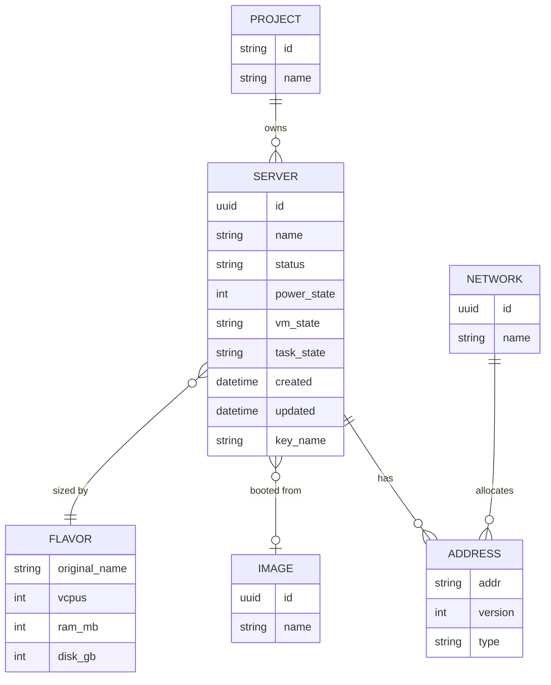

# ERD — Model Data

Worker v0.1 **stateless** (tanpa database). Diagram ini memetakan entitas OpenStack yang dibaca dan bentuk respons `VpsSummary`, plus rencana skema D1 fase 2.

## Pemetaan Nova → `VpsSummary`
| VpsSummary | Sumber Nova (microversion 2.47) |
|---|---|
| `powerState` | `OS-EXT-STS:power_state` (0 NOSTATE, 1 RUNNING, 3 PAUSED, 4 SHUTDOWN, 6 CRASHED, 7 SUSPENDED) |
| `ipv4` / `ipv6` | `addresses.*[].addr` dipisah berdasar `version` |
| `flavor.*` | `flavor.original_name/vcpus/ram/disk` (fallback `flavor.id` jika microversion lama) |
| `imageId` | `image.id`; `null` untuk boot-from-volume (`image: ""`) |

## Rencana fase 2 (D1, belum diimplementasi)
`server_snapshot(id PK, server_id, captured_at, status, power_state, ipv4_json, flavor_name)` — diisi Cron Trigger untuk riwayat status/uptime.
