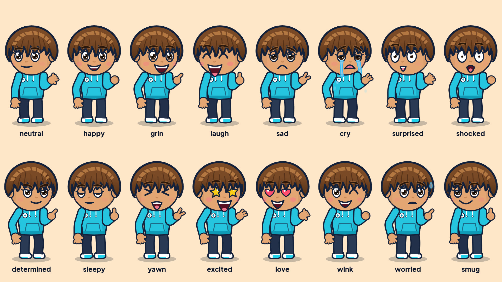
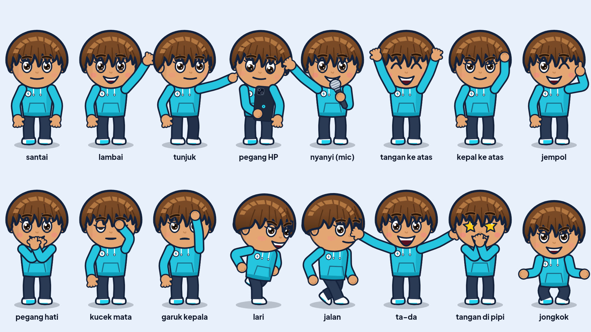
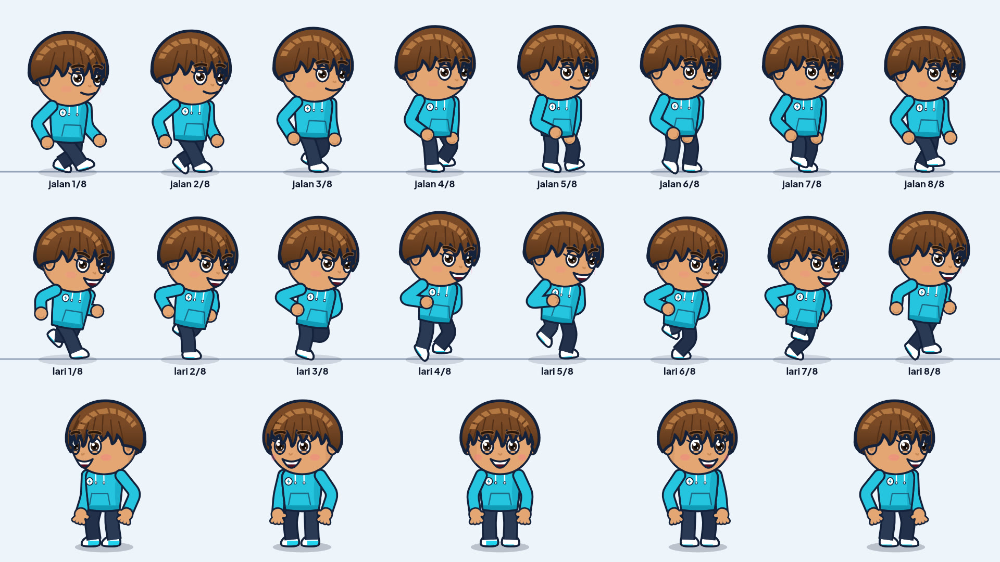
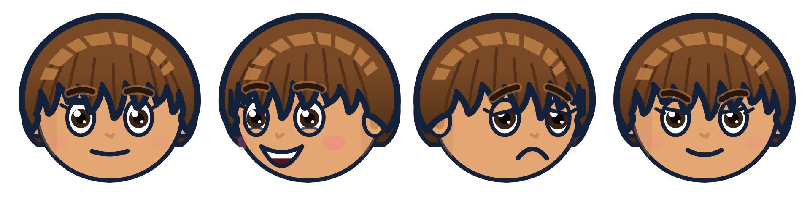
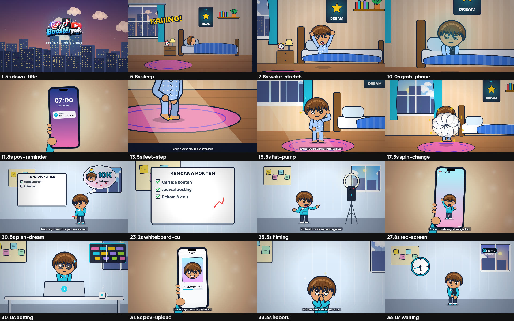
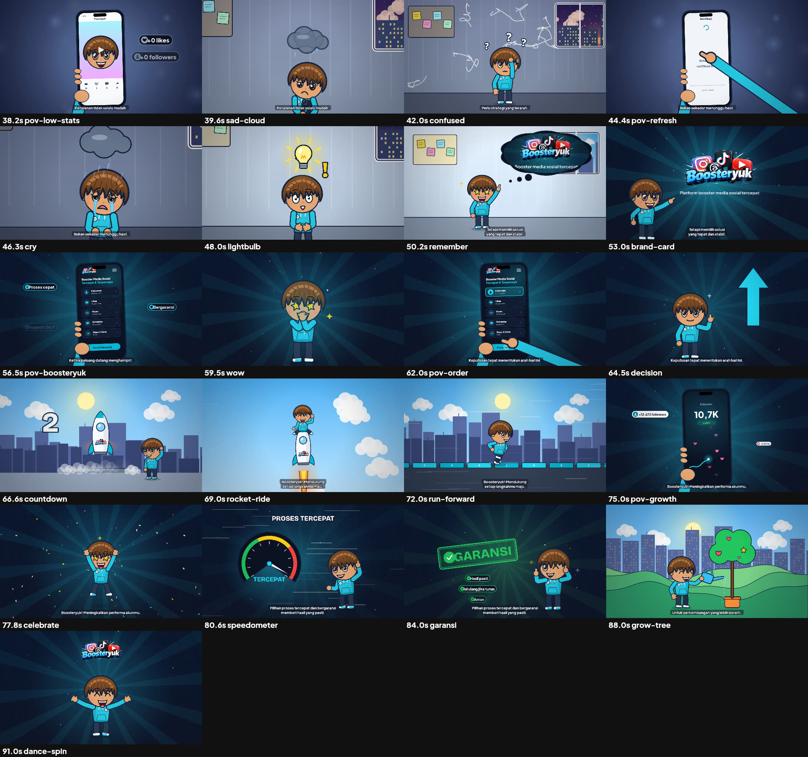
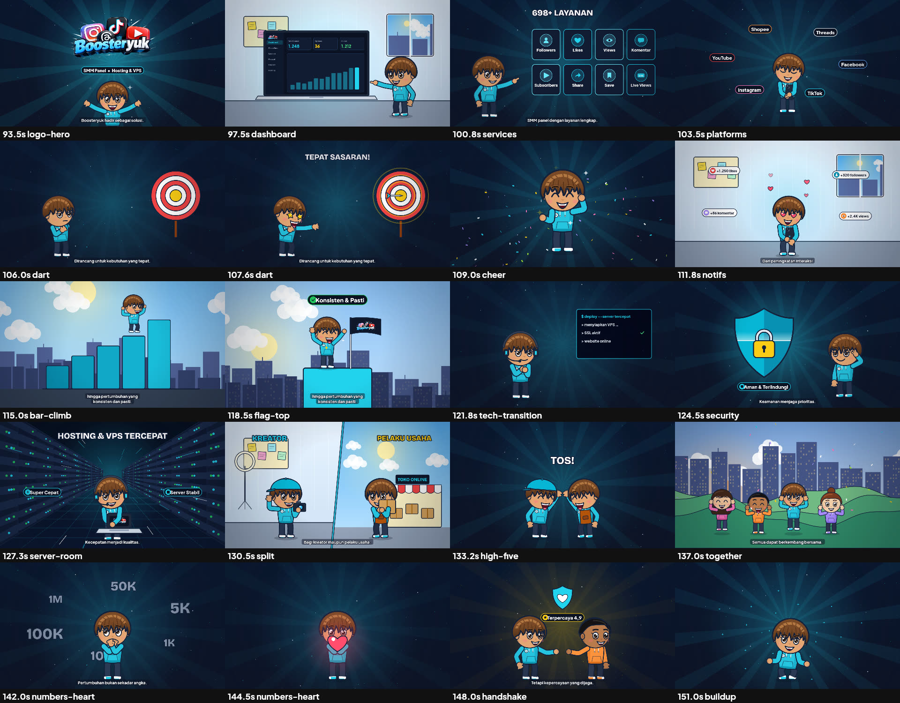
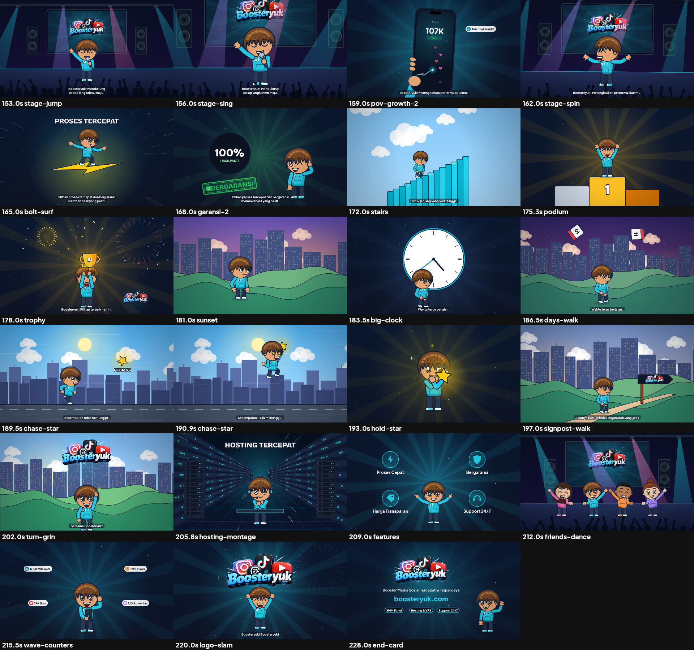

# Boosteryuk — Official Music Video (source)

Video musik animasi 1920×1080/30 fps sepanjang lagu (3:53,7), dibangun 100% dari kode: karakter kartun rubber-hose yang ekspresif, 77 shot yang disinkronkan ke beat, subtitle kecil di bawah-tengah.

## Build
```bash
npm install                       # @napi-rs/canvas + font brand (@fontsource)
pip install librosa fonttools brotli
python3 analysis/beats.py assets/song.mp3   # tempo, beat, envelope (sudah ada: analysis/beats.json)
node src/make.js --workers 2      # render semua shot -> concat -> mux audio -> SRT
```
Output:
- `out/Boosteryuk_Official_Music_Video_1080p.mp4`
- `out/Boosteryuk_lirik_ID.srt` (lirik bersih untuk CC)

Revisi satu/dua shot saja: `node src/make.js --only 12,13` (shot lain dipakai ulang dari `out/shots/`).

Uji rig: `node tests/gait_check.js` (slip & jangkauan kaki), `node tests/gait_sheet.js out/gait.png`, `node tests/arm_sheet.js out/arm.png`.

Preview frame: `node src/preview.js 12.5 70.2` atau contact sheet `node src/preview.js --sheet nama 1 2 3 …`.

## Struktur
| Path | Isi |
|---|---|
| `src/engine.js` | Konstanta, easing, keyframe, sinkronisasi beat, helper gambar, ikon |
| `src/character.js` | Rig karakter: lengan & kaki IK 3D anatomis, model kaki/sepatu, gait jalan/lari biomekanis, rig mic, rambut shaggy, 25+ ekspresi, kepala pseudo-3D |
| `src/bg.js` | Background: kamar, ruang kerja, kota, langit, panggung, ruang server, bukit, efek |
| `src/ui.js` | Wordmark brand, HP/laptop + layar (sosmed, Boosteryuk, dashboard), props |
| `src/shots1.js`, `src/shots2.js` | 77 shot (0:00–1:32, 1:32–3:53) |
| `src/timeline.js` | Driver frame, snap ke beat, transisi, subtitle |
| `src/subtitles.js` | Cue lirik bersih + ekspor SRT |
| `src/render.js`, `src/make.js` | Render per shot (ffmpeg) + build penuh |
| `assets/logo/` | Logo resmi Boosteryuk (PNG transparan) |
| `analysis/` | Analisis audio (librosa) |
| `docs/` | PRD, ADR, ERD/model data, storyboard, riset, audit |
| `WORKLOG.md` | Catatan kerja |

## Dokumen
[PRD](docs/PRD.md) · [ADR](docs/ADR.md) · [Model data/ERD](docs/DATA-MODEL.md) · [Storyboard](docs/STORYBOARD.md) · [Riset](docs/RESEARCH.md) · [Audit QA](docs/AUDIT.md)

## Cuplikan








