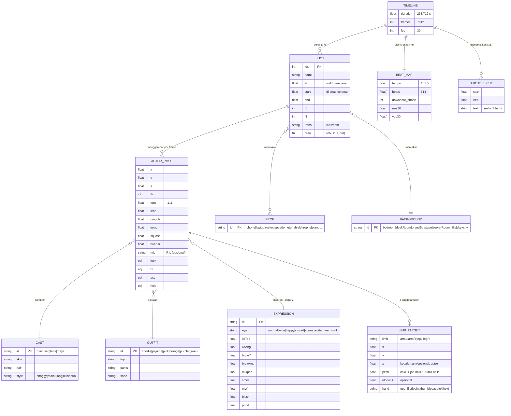

# Model Data (ERD) — Timeline Video

Video ini "data-driven": timeline adalah daftar entitas yang dievaluasi per frame. Model di bawah setara ERD untuk sistem render.

## Aturan integritas
- `SHOT.start` naik monoton; `SHOT.end = SHOT[i+1].start`; shot terakhir berakhir di `TIMELINE.duration`.
- Σ(`f1 − f0`) = `TIMELINE.frames` (7012) — diverifikasi di AUDIT.
- Karakter utama selalu `CAST=main`; outfit hanya `pajama` (adegan pagi) → `hoodie` (setelah ganti baju di 0:16).
- Lengan/kaki: panjang segmen tetap (62+58 / 50+48 + tinggi pergelangan 18); siku/lutut diselesaikan IK 3D + pole vector (ADR-005/006).
- Target kaki = titik kontak tanah di bawah pergelangan; gait jalan/lari dihitung dari jarak tempuh (slip 0).
- `SUBTITLE_CUE` tidak tumpang tindih; ≤ 2 baris; ≤ 42 karakter/baris.

## Lokasi kode
| Entitas | File |
|---|---|
| TIMELINE, frame driver | `src/timeline.js` |
| SHOT | `src/shots1.js`, `src/shots2.js` |
| ACTOR_POSE, CAST, OUTFIT, EXPRESSION | `src/character.js` |
| BACKGROUND | `src/bg.js` |
| PROP, UI layar | `src/ui.js` |
| BEAT_MAP | `analysis/beats.py` → `analysis/beats.json` |
| SUBTITLE_CUE | `src/subtitles.js` |
